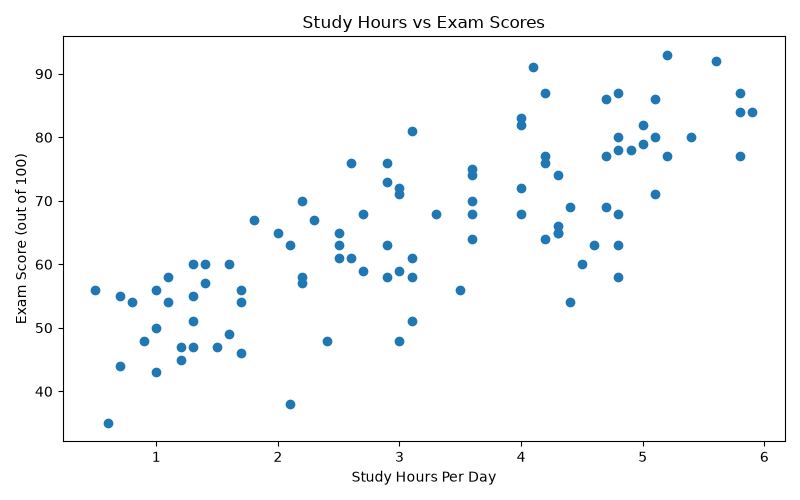
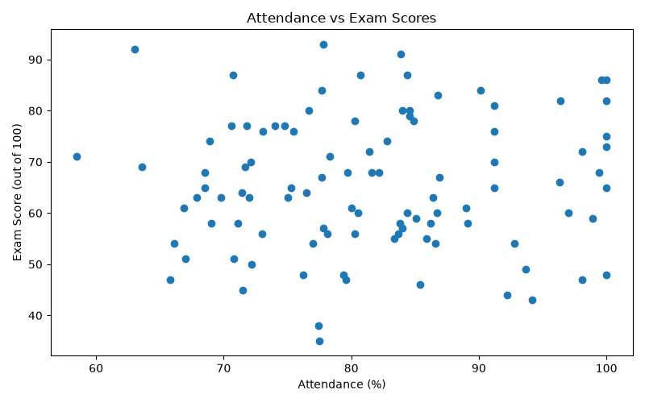
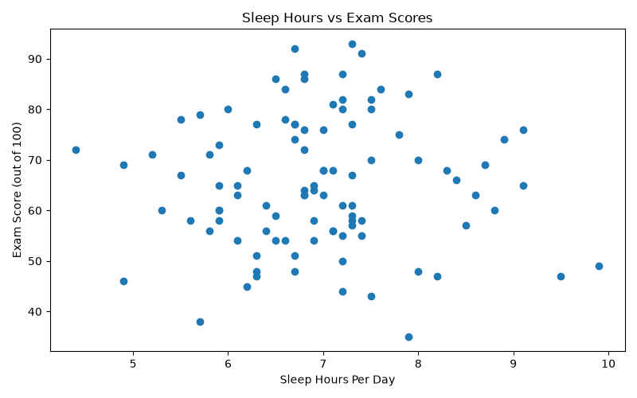

# Student Performance Analysis
## Exploratory Data Analysis with a Finding

### 1. Project Overview

This project explores the relationship between students' daily study hours, attendance, sleep hours, and exam scores. Python was used to analyse the dataset, calculate correlations, create visualisations, and build an interactive dashboard.

The objective is to identify which of the three factors has the strongest linear relationship with exam scores and investigate whether the initial expectations are supported by the data.

### 2. Dataset Description

- **Dataset name:** Student Performance Analysis Dataset
- **Number of student records:** 100
- **Data type:** Synthetic practice data
- **Tools used:** Python, Pandas, Matplotlib, Plotly, Streamlit
- **Analysis method:** Exploratory Data Analysis (EDA), correlation analysis, and visualisation

The dataset contains the following variables:

| Variable | Description |
|---|---|
| Student ID | Unique identifier for each student |
| Study Hours Per Day | Number of hours spent studying daily |
| Attendance Percent | Student attendance percentage |
| Sleep Hours Per Day | Number of hours slept daily |
| Exam Score Out of 100 | Student's exam score |

**Note:** This is synthetic practice data and does not represent real students.

### 3. Research Questions

1. Is daily study time positively associated with exam scores?
2. Does higher attendance correspond to higher exam scores in this dataset?
3. Is sleep duration linearly associated with exam scores?
4. Which of these three variables has the strongest linear relationship with exam scores?

### 4. Hypotheses

**Hypothesis 1: Study Hours**

Students who spend more hours studying per day tend to achieve higher exam scores.

**Hypothesis 2: Attendance**

Students with higher attendance percentages are expected to achieve higher exam scores.

**Hypothesis 3: Sleep Hours**

Students who sleep for more hours per day may have different exam scores.

These are exploratory expectations, not established facts. The analysis investigates whether the observed data supports them.

### 5. Data Analysis Method

The dataset was loaded and analysed using Python and Pandas. Correlation coefficients were calculated to measure the direction and strength of the linear relationships between the three variables and exam scores.

Correlation coefficients range from -1 to +1:

- A value close to +1 indicates a strong positive linear relationship.
- A value close to -1 indicates a strong negative linear relationship.
- A value close to 0 indicates little or no linear relationship.

Scatter plots were created to inspect the relationships visually. An interactive Streamlit dashboard was also developed to explore the data.

### 6. Results and Evidence

The analysis produced the following correlation values:

| Variable | Correlation with Exam Score | Interpretation |
|---|---:|---|
| Study Hours Per Day | 0.772 | Strong positive linear relationship |
| Attendance Percent | 0.051 | Almost no linear relationship |
| Sleep Hours Per Day | 0.002 | Almost no linear relationship |

#### Finding 1: Study Hours Had the Strongest Relationship

The correlation between daily study hours and exam scores was **0.772**. This indicates a strong positive linear relationship in the synthetic dataset.

The study-hours scatter plot provides visual evidence for this pattern. Among the three variables examined, study hours had the strongest observed linear association with exam scores.

This finding supports Hypothesis 1 within this dataset. However, it does not establish that increasing study hours will automatically cause higher scores.

#### Finding 2: The Attendance Expectation Was Not Supported

An initially promising expectation was that students with higher attendance would also have higher exam scores.

However, the observed correlation was only **0.051**, which is very close to zero. The analysis therefore did not find a meaningful linear relationship between attendance and exam scores in this dataset.

This result does not support Hypothesis 2 in the expected direction. It does not prove that attendance is unimportant in real educational settings.

#### Finding 3: Sleep Hours Showed Almost No Linear Relationship

The correlation between sleep hours and exam scores was **0.002**, which is approximately zero.

This means the analysis found almost no linear relationship between sleep duration and exam scores in this synthetic dataset. It does not establish that sleep has no effect on students' academic performance.

### 7. Visualisations

The following charts were generated during the analysis.

#### 7.1 Study Hours vs Exam Scores

This chart helps examine whether exam scores tend to increase as daily study hours increase.

#### 7.2 Attendance vs Exam Scores

This chart helps inspect whether students with higher attendance tend to achieve higher exam scores.

#### 7.3 Sleep Hours vs Exam Scores

This chart helps inspect the relationship between daily sleep duration and exam scores.

**Chart interpretation:** Each chart should display a descriptive title, clearly labelled horizontal and vertical axes, and appropriate units. The chart images should be saved in the same folder as this Markdown report so the relative image links work.

### 8. Main Finding for a Stakeholder

The strongest finding in this analysis is that **study hours had a much stronger positive linear relationship with exam scores than attendance or sleep hours in this dataset**.

The study-hours correlation was 0.772, compared with 0.051 for attendance and 0.002 for sleep hours. The initial expectation that higher attendance would correspond to higher scores was not supported by the observed correlation.

A stakeholder should interpret these results as an exploratory finding from a practice dataset, not as evidence for making real student assessment or education policy decisions.

### 9. Limitations

1. The dataset is synthetic and may not reflect real student behaviour or academic performance.
2. Correlation measures linear relationships and may not capture nonlinear patterns.
3. Correlation does not prove causation.
4. Other potentially important factors, such as prior academic performance, teaching quality, study methods, and exam difficulty, were not evaluated.
5. The analysis is based on 100 records and should not be generalised to all students.

### 10. Conclusion

This exploratory analysis examined the relationships between study hours, attendance, sleep hours, and exam scores.

Study hours showed the strongest positive linear relationship with exam scores, with a correlation of 0.772. Attendance and sleep hours showed almost no linear relationship with exam scores in this dataset.

The analysis demonstrates how exploratory data analysis can test initial expectations, identify patterns, and communicate findings using statistical measures and charts. Further analysis using reliable real-world data would be necessary before drawing conclusions about actual students.

### 11. Project Files

- `Student_Performance_Analysis_Dataset.csv` — dataset used for analysis
- `analysis.py` — Python analysis and visualisation script
- `dashboard.py` — interactive Streamlit dashboard
- `analysis_summary.txt` — summary of the correlation results
- `study_hours_vs_scores.png` — study-hours scatter plot
- `attendance_vs_scores.png` — attendance scatter plot
- `sleep_hours_vs_scores.png` — sleep-hours scatter plot

### 12. Tools and Technologies

- Python
- Pandas
- Matplotlib
- Plotly
- Streamlit
- Exploratory Data Analysis
- Correlation Analysis
- Data Visualisation